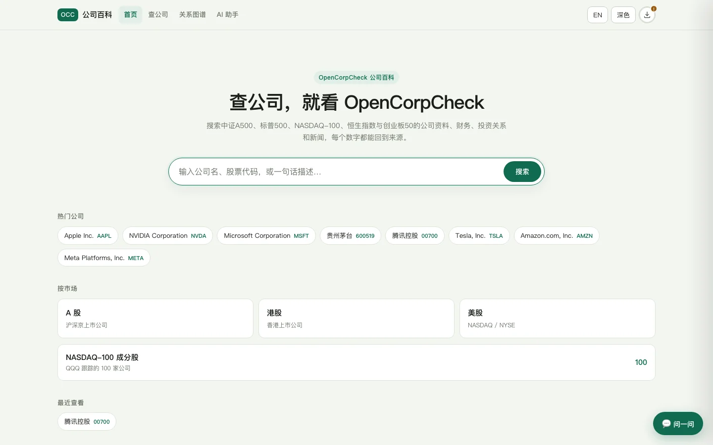
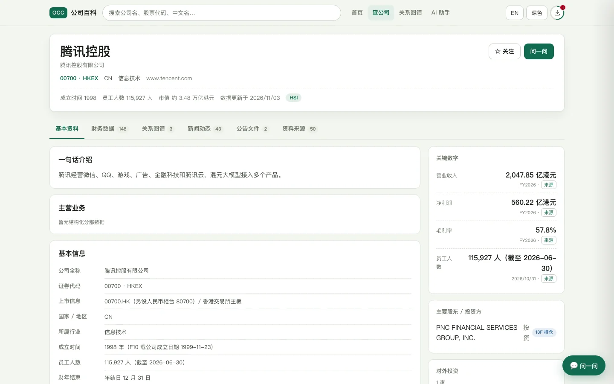
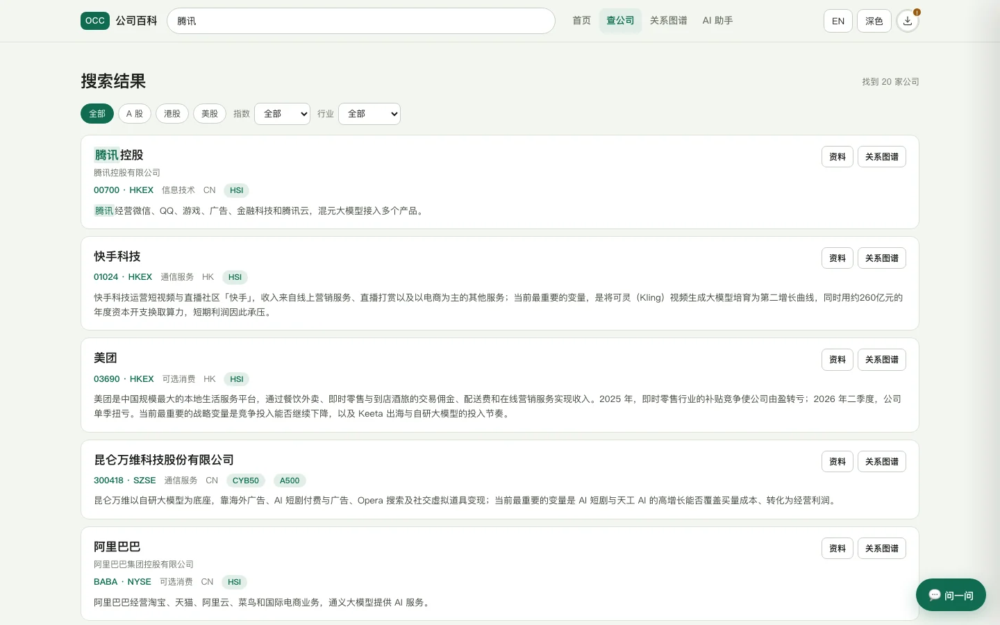
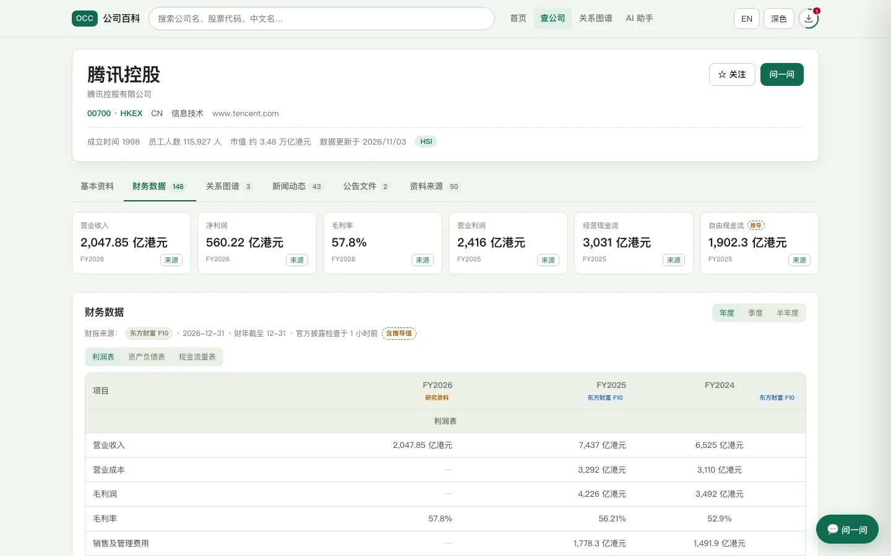
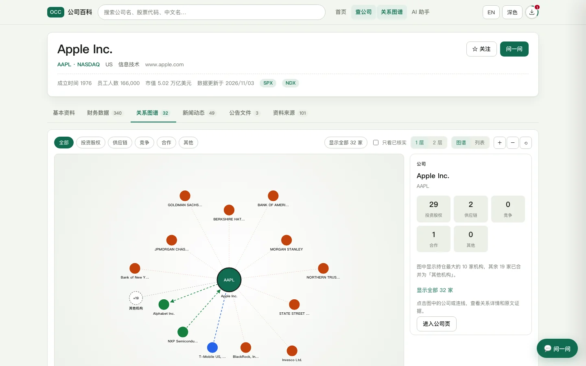
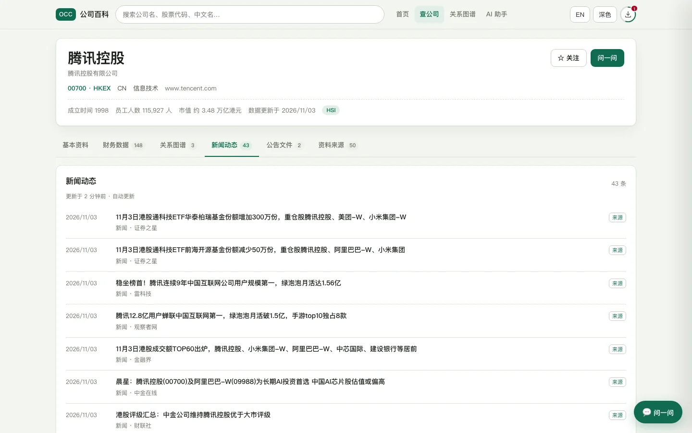
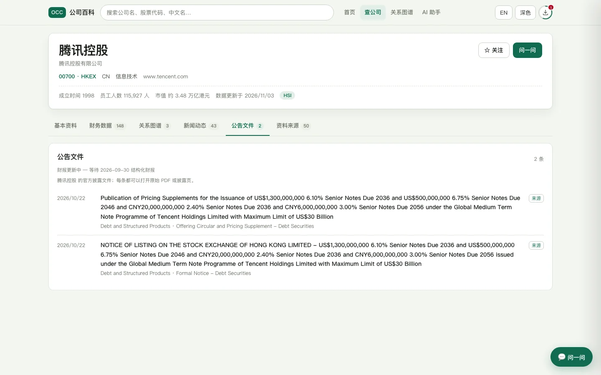
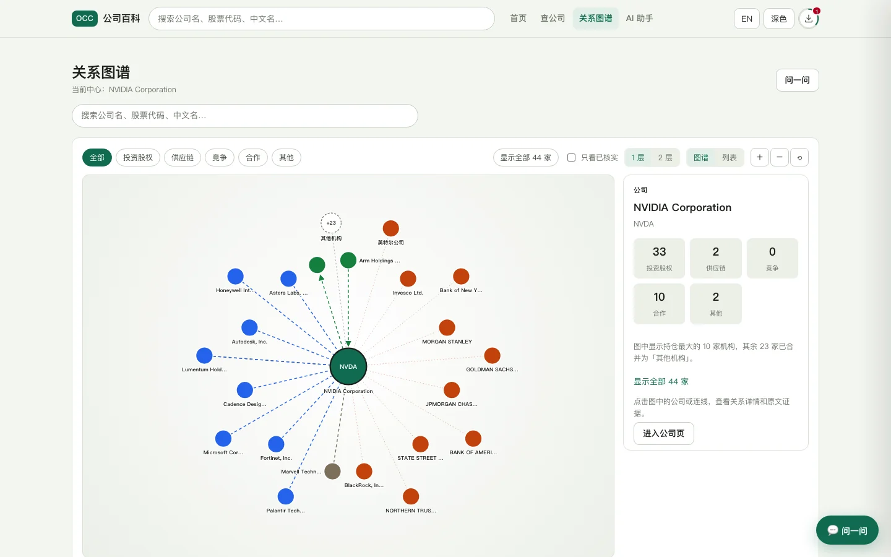
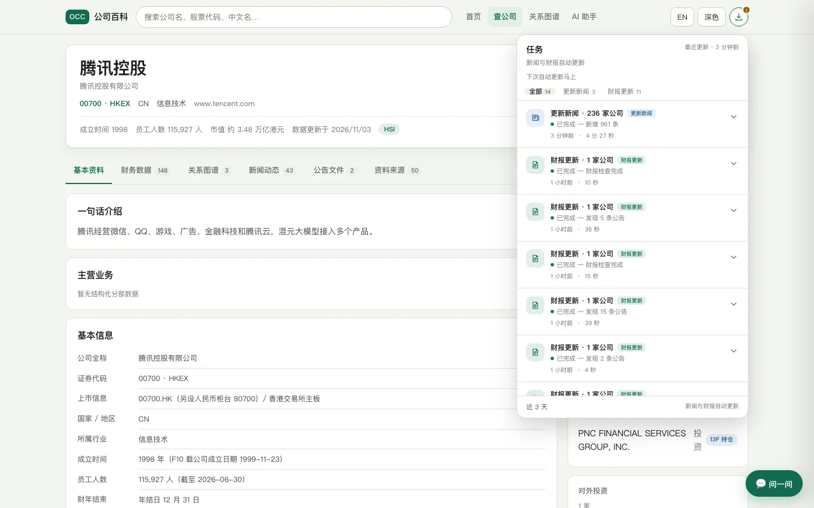
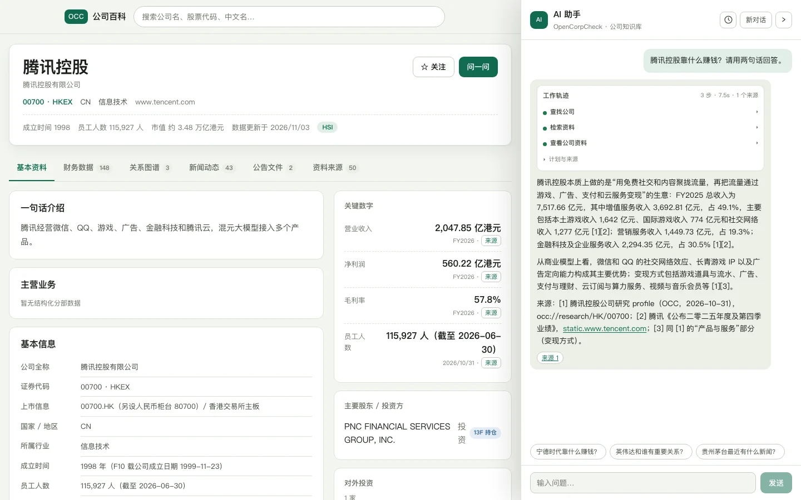

# OpenCorpCheck · 开源公司情报

> **像用企查查一样查上市公司：搜一家公司，一页看完基本资料、财务数据、投资关系、新闻和公告；每个数字都能点回原始来源。**

**简体中文（默认）** · [English](README.en.md)

OpenCorpCheck 是一个开源、可自行部署的「公司情报」工具，面向**非技术出身的股民**和**普通金融从业者**。它把 SEC EDGAR、港交所、巨潮资讯、东方财富 F10 等分散的数据整理成一张可搜索、可追溯的公司卡片，并用关系图谱和 AI 助手帮助理解公司之间、股东与公司之间的关系。

> 当前是 v0.1 本地开发版（2026-11-03）。代码开源，数据抓取在本地完成；项目**不提供**投资建议、交易信号或付费数据。



---

## 这是什么

OpenCorpCheck 覆盖 5 个指数的 1,086 家公司：

- **236 家已研究公司**：NASDAQ-100（100）、恒生指数（85）、创业板 50（50），以及少量额外发现的公司。每家都有公司资料、新闻、关系图谱和来源，绝大多数有结构化财务数据。
- **850 家 A500 / 标普 500 占位公司**：可以搜索和打开页面，但只有代码、名称、市场和指数成分信息，页面标注「未收录」。

它想解决的是三个具体问题：

1. **数据太散**：财报在 EDGAR / 巨潮，公告在交易所，股东在 13F / 权益披露，新闻在各处。
2. **商业产品不透明**：多数公司情报产品是闭源的、按地区分割的，更偏工商和风险数据，而不是投资研究。
3. **AI 容易编**：通用大模型能写公司分析，但数字没有出处，也无法稳定更新。



## 目标用户

| 用户 | 想解决什么 | 熟悉的工具 |
|---|---|---|
| 非技术股民 | 这家公司靠什么赚钱、和谁有关系、最近发生了什么 | 同花顺、东方财富、雪球、企查查 |
| 普通金融从业者 | 快速了解一家公司、核对一个数字、看投资关系 | Wind、企查查、天眼查、公司公告 |
| 记者 / 内容创作者 | 找到原始来源、复制引用 | 搜索引擎、企查查 |
| 学生 / 求职者 | 这家公司是做什么的、在哪里 | 百度、企查查 |

共同点是：看得懂财务名词，但不想读原始财报；习惯「搜索 → 公司页 → 切 tab」；会用聊天框提问，但不关心 BM25、向量检索或置信度这些内部概念。

## 和企查查类产品有什么不同

| | 企查查 / 天眼查类产品 | OpenCorpCheck |
|---|---|---|
| 定位 | 工商、司法、风险数据平台 | 面向投资研究的公司情报 |
| 开放性 | 闭源、会员制 | 开源，可自己部署和修改 |
| 数据来源 | 平台整理后的结果 | 每个数字 / 关系都能点回原文、引用和抓取时间 |
| 覆盖范围 | 全国企业 | 5 个指数 + AI 观察名单（明确的边界） |
| 输出方式 | 风险标签、评分 | 给证据和来源，不替你做投资结论 |
| 更新方式 | 平台统一更新 | 本地定时任务；新财报自动更新结构化财务数据 |

OpenCorpCheck 借用企查查已经被验证过的信息架构（搜索 → 公司页 → tab），但**不抄品牌、不做付费墙、不做批量导出**。「企查查」是其权利人的商标，本项目与之没有关联。

## 功能一览

### 搜索

支持公司名、中文名、ticker、拼音/别名和一句话描述。结果可以直接按市场、指数和行业筛选。



### 公司页：六个 tab

| Tab | 内容 |
|---|---|
| **基本资料** | 公司简介、行业、地区、关键数字、主要关系 |
| **财务数据** | 结构化利润表 / 资产负债表 / 现金流，标注期间和来源 |
| **关系图谱** | 中心公司 + 投资 / 股东 / 母子公司关系；支持 1–2 层下钻，图和列表双视图 |
| **新闻动态** | 按时间排列的新闻，保留原文链接 |
| **公告文件** | 官方公告和文件（10-K、10-Q、年报、临时公告等），可打开 PDF |
| **资料来源** | 去重后的来源列表，便于核对 |

每个财务数字、关系证据和新闻都带「来源」，点开是原文引用、网页链接和抓取时间。

<table>
  <tr>
    <td width="50%"></td>
    <td width="50%"></td>
  </tr>
  <tr>
    <td width="50%"></td>
    <td width="50%"></td>
  </tr>
</table>

跨公司的全局关系图谱可以按公司切换（以 NVIDIA 为例）：



更多截图：[资料来源 tab](docs/screenshots/readme/sources.webp) · [手机端财务数据](docs/screenshots/readme/mobile-financials.webp)。

### 自动更新任务坞

页面右下角的任务坞显示两类自动任务：

- **更新新闻**：每天检查一次各公司的新闻源（RSS），只入库新文章。
- **财报更新**：每天检查 EDGAR / 巨潮 / HKEXnews 的公告索引；发现新的定期报告时，自动重新解析结构化财务数据。

任务坞支持「全部 / 更新新闻 / 财报更新」筛选。A 股和港股的 F10 数据可能晚于公告，系统会把状态标为「待更新」，并按 1 小时 / 6 小时 / 1 天的间隔重试，最多 7 天。**首次检查只是建立基线，不是历史回填。**

这条数据路径是确定性的，**0 LLM tokens**；只有研究、抽取和 AI 助手会调用大模型。



### AI 助手

右侧的 AI 助手基于 DeepSeek Harness（ACP），可以带着当前公司上下文提问。公司事实来自 OpenCorpCheck 数据库，网页搜索使用 dsh 的内置能力；回答会引用数据库里的来源。

AI 助手是**可选**功能，需要自己的 `DEEPSEEK_API_KEY`，并且可能出错——它不替代原文核对。



### 指数页与占位公司

NDX、HSI、CYB50、A500、SPX 各有一个成分页。A500 和 S&P 500 目前是**占位页**：可以搜索、可以看成分，但没有逐家公司的深度资料和结构化财务数据。北京证券交易所 / 科创板等标的不在当前范围内。

### 开发者入口

Web UI 之外，还提供 `occ` CLI、MCP server 和 REST/OpenAPI。审核队列、研究运行和检索 explain 只保留在 CLI / 内部页面，不出现在公开 UI。

## 数据范围

截至 2026-11-03：

| 指数 | 成分 | 已研究 | 结构化财务数据 | 状态 |
|---|---|---|---|---|
| NASDAQ-100 | 100 | 100 | 100 家（SEC XBRL） | 完成 |
| 恒生指数 | 85 | 85 | 84 家（F10；1 家 F10 页面为空） | 完成 |
| 创业板 50 | 50 | 50 | 50 家（F10） | 完成 |
| 中证 A500 | 500 | — | — | 占位页 |
| 标普 500 | 500 家公司 / 503 只证券 | — | — | 占位页 |
| 科创 50 | — | — | — | 未做（下一步试点） |

其他数据：

- 1,086 家非 fixture 公司，其中 850 家是 A500 / SPX 占位公司；
- 13,009 条美股 13F 机构持仓关系、90 条港交所权益披露关系；
- 5,248 篇新闻文档；
- 公告文件采用「按需批量」方式抓取，不是全量自动回填。

> A500/SPX 的占位公司是有意为之：先把「可搜索」和「有真实页面」做出来，再决定是否逐家研究。STAR 50 是下一步试点；历史回填仍不在当前计划里。

## 架构

```text
浏览器（React 19 + Vite）
  │  REST /v1 + SSE
  ├── API（Node 24）
  │     ├── Postgres 17      公司 / 事实 / 关系 / 公告 / 任务状态的真相库
  │     ├── Qdrant 1.18      关键词 + 稠密 + 稀疏混合检索（RRF / DBSF）
  │     └── pg-boss          研究 / 新闻 / 财报 / 公告任务队列
  ├── Python sidecar :8090   Eastmoney F10 / PDF 解析 / HKEXnews（Playwright）
  └── dsh ACP 助手           DeepSeek + MCP 工具（公司数据、搜索）
```

设计原则：

- **Postgres 是真相库**，Qdrant 只做检索索引；两者都能从原始数据重建。
- **抓取与解析分离**：原始 HTML / PDF 先落盘（含 SHA-256），再用可版本化的解析器抽取。
- **确定性的归确定性**：新闻、公告、财报刷新不调用大模型；大模型只用于研究和解释。
- **每个事实都有来源**：URL、引用、页面、抓取时间、抽取器版本；没有来源就没有事实。

## 快速开始

### 环境要求

| 依赖 | 版本 / 说明 |
|---|---|
| macOS 13+ 或 WSL2 / Linux | 原生运行，**不需要 Docker** |
| Node.js | ≥ 24.9 |
| pnpm | 12.15（通过 `corepack`） |
| PostgreSQL | 17（`scripts/dev-db.sh`） |
| Qdrant | 1.18（`scripts/dev-qdrant.sh` 自动下载） |
| Python + uv | 3.12，用于嵌入服务和 F10 sidecar（`brew install uv`） |
| 磁盘 | 约 10 GB（嵌入模型首次下载约 2.3 GB） |
| API Key | 研究 / 抽取 / AI 助手需要 `DEEPSEEK_API_KEY`；只看已有数据不需要 |

### 启动

```bash
# 1. 配置
cp .env.example .env
# 按需填入 DEEPSEEK_API_KEY；不要提交 .env

# 2. 基础设施（原生进程）
scripts/dev-db.sh init          # 仅第一次
scripts/dev-db.sh start
scripts/dev-qdrant.sh start
scripts/dev-embeddings.sh start # 首次会下载 BAAI/bge-m3
scripts/dev-minio.sh start      # 可选，原始快照

# 3. 安装与构建
corepack pnpm install
corepack pnpm -r build

# 4. 建表
node apps/cli/dist/occ.js migrate

# 5. 启动 API 与 Web
node apps/api/dist/server.js                 # http://127.0.0.1:8787
corepack pnpm dev:web                        # http://127.0.0.1:5173

# 6. 自动更新 worker（另开两个终端）
scripts/dev-news-worker.sh start             # 新闻
scripts/dev-data-worker.sh start             # 财报 / 公告

# 7. A 股 / 港股数据需要 F10 sidecar
cd services/finance-analyst
uv sync
uv run playwright install chromium
uv run occ-f10 serve --port 8090
```

### 准备数据

仓库**不附带**数据库或完整语料。全新数据库是空的：

```bash
# 指数成分快照因许可原因不随公开仓库发布。
# A500 / SPX 可按官方来源重新生成（输出到本地 config/indices）：
uv run scripts/snapshot-indices.py

# NDX / HSI / CYB50 快照请按 docs/DATA_SOURCES.md 记录的官方来源自行生成。

# 从快照创建指数成分和 A500 / SPX 占位公司
node apps/cli/dist/occ.js indices sync

# 研究 / 抽取需要 DeepSeek Key（会消耗 token，且耗时）
node apps/worker/dist/cli.js enqueue research --universe ndx
node apps/worker/dist/cli.js work --queues research,ingest,review
```

也可以只查看已有公司：

```bash
node apps/cli/dist/occ.js search 茅台
node apps/cli/dist/occ.js company AAPL --include financials,facts,relations,events
```

### 公告与财报

```bash
# 单个公司试跑（默认 dry-run；--apply 才写库）
node apps/cli/dist/occ.js filings sync --market US --company AAPL --days 90 --max-items 5
node apps/cli/dist/occ.js filings sync --market A --company 600519 --days 180 --skip-pdf --apply

# 每天自动检查一次（任务坞里的「财报更新」）
node apps/worker/dist/refresh-cli.js status
node apps/worker/dist/refresh-cli.js sweep --now
```

### 测试

测试会共享本地数据库和端口，**必须串行跑**：

```bash
corepack pnpm -r --workspace-concurrency=1 test
```

更多命令见各模块 README 和 [docs/ARCHITECTURE.md](docs/ARCHITECTURE.md)。

## 数据来源与许可

| 来源 | 用途 | 许可 / 使用方式 |
|---|---|---|
| SEC EDGAR（XBRL、submissions、13F） | 美股财务数据、公告、机构持仓 | 公共领域；遵守 10 req/s、带联系方式的 User-Agent |
| CNINFO / 上交所 / 深交所 | A 股公告 | 公开披露；存储证据并引用，不冒充授权数据 |
| HKEXnews / HKEX DION | 港股公告、权益披露 | 公开站点；礼貌限速，不做批量再分发 |
| 东方财富 F10 | A / 港股结构化财务数据、公司资料 | 专有数据；仅本地研究使用并注明来源，不批量再分发原始数据 |
| Google News RSS | 新闻发现 | 仅保存标题 / 链接，正文回到原站 |
| GLEIF | LEI、母公司关系 | CC0 |
| Wikidata / Wikipedia | 实体标识、指数成分交叉核对 | CC0 / CC BY-SA（保留署名） |
| 指数成分快照 | NDX、HSI、CYB50、A500、SPX | 内部研究快照；不批量再分发，不作为授权数据源 |

原则：

- **官方优先**：交易所公告和监管披露是最终引用来源；F10 是覆盖层，不是最终裁定。
- **礼貌抓取**：遵守 robots.txt 和站点条款，按域名限速，不绕过登录、付费墙或 CAPTCHA。
- **不做数据供应商**：仓库只包含代码、适配器和少量结构说明，不包含批量专有数据。
- 复用 Apache-2.0 代码时保留许可证与 NOTICE；本项目引用 `finance_analyst` 的抓取思路和部分实现。

## 可信度原则

1. **每个数字 / 关系都能回到来源**（URL + 引用 + 页面 + 抓取时间）。
2. **推导出来的数字有标记**（例如 `计算：` 毛利率、总负债），不伪装成原始披露。
3. **自动数据路径 0 LLM tokens**：新闻、公告、财报刷新都是确定性代码。
4. **机器抽取不等于已核实**：低置信度或冲突的信息进入人工复核队列，标记为「待核实」；未复核的关系不会当成事实。
5. **缺失就说暂无数据**：不猜、不补 0、不拿 fixture 当真实公司。

## 已知限制

- **A 股 / 港股 F10 有延迟**：结构化财务数据可能晚于公告；系统会重试，但期间显示「待更新」。
- **没有 OCR**：扫描版 / 纯图片 PDF 只能保留链接，无法抽取正文。
- **EDGAR 近窗**：只读取 `submissions.filings.recent`，不追更早的分页文件；日常增量检查足够，历史回填不在计划内。
- **首次检查是基线**：不会自动补齐此前的历史公告。
- **占位公司**：A500 / S&P 500 只有基础信息；另有 1 家港股公司行业为空（F10 页面无法渲染）。
- **13F 名称匹配保守**：只做精确名称匹配，部分 ADR / 名称变体会漏掉。
- **没有 CI、没有打包**：P2（Docker / Electron / 托管 demo / 可观测性）按当前机器约束延后。
- **AI 助手可能出错**：需要自己的 Key，回答必须回到原文核对。

## 路线图

- **当前**：完成开源准备（中文 README、许可证与社区文件、真实截图）。
- **延后**：P2 交付与工程质量（Docker / Electron / 托管 demo / CI / 可观测性）。
- **下一步**：STAR 50 试点 + review-loop 的按问题类型路由。
- **不在当前计划**：A500 / SPX 逐家研究、历史公告回填、手动刷新按钮、K 线 / 组合、账号系统。

路线图与已完成工作记录在 [docs/ROADMAP.md](docs/ROADMAP.md)。

## 参与贡献

请先读 [CONTRIBUTING.md](CONTRIBUTING.md)。几条底线：

- 不提交密钥、`.env`、本地数据库 / 向量库 / 缓存；
- 测试必须串行：`corepack pnpm -r --workspace-concurrency=1 test`；
- 不新增绕过限制的抓取，不批量抓取或再分发专有数据；
- 数据修正走复核队列，不直接改公开页面；
- 文档以中文为主，英文为辅。

## 免责声明

本项目是研究和工程实验，**不是投资建议**，不构成任何买卖要约或推荐。数据可能延迟、缺失或在抽取中出错；一切以公司公告、交易所和监管机构的官方披露为准。使用本项目做出的任何决策由使用者自行负责。

## License

- **代码**：[Apache-2.0](LICENSE)。数据来源署名见 [NOTICE](NOTICE)。
- **数据**：各来源保留自己的许可；详见 [docs/DATA_SOURCES.md](docs/DATA_SOURCES.md)。
- 「企查查」是其权利人的商标；OpenCorpCheck 与之没有关联，也不代表其立场。
